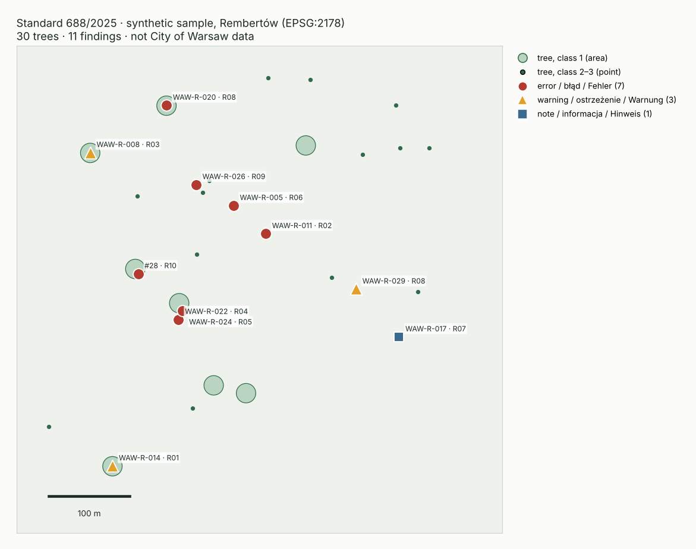

[English](README.md) | [Polski](README.pl.md) | **Deutsch**

# VORO Tree Standard QA

[](https://github.com/MR73BIIO/voro-tree-standard-qa/actions/workflows/tests.yml)


[](https://doi.org/10.5281/zenodo.23624898)

**Prüft Baumkatasterdaten gegen das Regelwerk des Auftraggebers vor der Abnahme und zeigt jedes Problem auf der Karte.**



Eine Bauminventur wird als GeoPackage übergeben und meist nach Augenmaß geprüft. Dieses Werkzeug übersetzt das Regelwerk des Auftraggebers in Regeln, die jedes Mal gleich laufen: gleiche Daten, gleiches Ergebnis, mit Verweis auf den Abschnitt. Das erste Regelpaket ist der Warschauer *Standard für Baumkontrollen und dendrologische Analysen* (Verfügung 688/2025).

Webseite (Rechner und Tabellenprüfung, PL/DE/EN): https://mr73biio.github.io/voro-tree-standard-qa/#de

## Was geprüft wird

10 Regeln, Beschreibung in [rules/warszawa_688/RULES.md](rules/warszawa_688/RULES.md):

- Risikoklasse 1–3 (alte 5-stufige Skala wird markiert),
- Nutzungskategorie O/N/S/W dort, wo der Standard sie verlangt, und nicht dort, wo er sie nicht vorsieht,
- Termin der nächsten Kontrolle gegen die Intervallmatrix aus Anlage 7,
- Geometrietyp gegen die Klasse (Klasse 1 als Fläche, Klassen 2 und 3 als Punkte),
- fehlende oder doppelte Inventarnummern, fehlerhafte Daten, Stammumfang ≤ 60 cm.

Jeder Befund hat ein Gewicht (Fehler, Warnung, Hinweis), eine Meldung auf Polnisch, Deutsch und Englisch und einen Verweis auf den Standard.

## Schnellstart

```bash
git clone https://github.com/MR73BIIO/voro-tree-standard-qa.git
cd voro-tree-standard-qa
python3 -m venv .venv && . .venv/bin/activate
pip install -e ".[dev]"
python tools/make_sample.py
vtsqa data/sample/rembertow_syntetyczne.gpkg --lang de
```

Ergebnis: `rembertow_syntetyczne_findings.gpkg` (Layer `findings`) und Bericht `rembertow_syntetyczne_findings.de.md`.

Auf der synthetischen Datei: 30 Bäume, 7 Fehler, 3 Warnungen, 1 Hinweis. Alle 11 absichtlich eingebauten Fehler gefunden, keine Fehlalarme.

### Als Qualitätsschranke

```bash
vtsqa lieferung.gpkg --fail-on blad
```

Exit-Code 1 bei mindestens einem Fehler. So kann die Prüfung einen Prozess anhalten, bevor die Daten rausgehen.

## In QGIS

1. Layer `drzewa` aus `data/sample/rembertow_syntetyczne.gpkg` hinzufügen.
2. Layer `findings` aus der Ergebnisdatei hinzufügen.
3. Auf `findings`: Eigenschaften → Symbolisierung → Stil → Stil laden → `qgis/findings.qml`.

Rote Kreise sind Fehler, gelbe Dreiecke Warnungen, blaue Quadrate Hinweise. Beim Überfahren eines Punktes erscheint die Meldung auf PL, DE und EN und der Abschnitt des Standards.

## Beispieldaten

`data/sample/rembertow_syntetyczne.gpkg` ist **synthetisch**: 30 Bäume im Bereich der Grawerska-Straße in Rembertów, erfundene Attribute, 11 absichtlich eingebaute Fehler. Keine Daten der Stadt Warschau. Jeder Datensatz hat `zrodlo = SYNTETYCZNE`. Prüfung der öffentlichen Daten: [rules/warszawa_688/R0.md](rules/warszawa_688/R0.md).

## Was es nicht tut

Es bewertet nicht den Zustand des Baumes und ersetzt keine Baumkontrolle durch Fachleute. Es prüft, ob die Einträge den Regeln des Standards entsprechen.

## Stand

Version 0.1.0. Nächste Etappen und Abschlusskriterien: [ROADMAP.md](ROADMAP.md#de). Änderungen: [CHANGELOG.md](CHANGELOG.md).

## Lizenz

Code: GPL-2.0-or-later ([LICENSE](LICENSE)). Beispieldaten, Regelbeschreibung, QGIS-Stil und Doku: CC BY 4.0 ([LICENSE-DATA.md](LICENSE-DATA.md)). Zitieren: [CITATION.cff](CITATION.cff).

---

Marcin Ruszczak (MR73BIIO) · ORCID [0009-0004-0170-4277](https://orcid.org/0009-0004-0170-4277) · Polnisch · Deutsch · Russisch · Englisch
